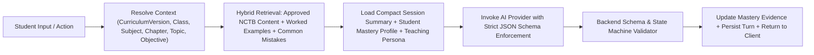

# AI Tutoring Engine, RAG & Mastery Calculation Specification

This document specifies the internal engineering of the **AI Orchestration Layer**, **Pedagogical State Machine**, **Retrieval-Augmented Generation (RAG) Pipeline**, and **Student Mastery Engine**.

---

## 1. Decomposed AI Service Architecture

Instead of one monolithic mega-prompt, the platform coordinates **9 specialized AI services** behind `App\Modules\AI\AIOrchestrator`:

| Service Class | Responsibility | Recommended Model Tier |
| :--- | :--- | :--- |
| `TutorEngineService` | Interactive step-by-step teaching, misconception diagnosis, progressive hints | Frontier / Reasoning Tier (e.g., Gemini 2.5 Pro / GPT-4o / Claude 3.7 Sonnet) |
| `StudyPlannerAiService` | Sequences backend-calculated tasks into encouraging Bangla daily agendas | Fast / Efficient Tier (e.g., Gemini 2.5 Flash / GPT-4o-mini) |
| `QuestionGeneratorService` | Generates NCTB syllabus-aligned MCQs, short questions, and *সৃজনশীল* stems | Frontier Tier + Human Reviewer Approval |
| `AnswerEvaluatorService` | Evaluates typed and OCR-transcribed answers against structured `MarkingRubric` | Frontier Tier (Deterministic JSON output) |
| `HandwritingOcrService` | Multimodal OCR for Bangla handwriting, English text, and LaTeX math equations | Vision-Specialized Multimodal Tier |
| `LearningAnalystService` | Synthesizes mastery logs into actionable Bangla mentorship advice | Fast / Efficient Tier |
| `ExamGeneratorService` | Assembles balanced examination papers matching NCTB mark distributions | Deterministic Blueprint + Fast Tier |
| `RecommendationService` | Suggests next optimal learning objectives and remedial revision modules | Rule Engine + Fast Tier |
| `GroupTutorEngineService` | Moderates 3–5 student batch classes and raise-hand question turns | Frontier / Fast Hybrid Tier |

---

## 2. Retrieval-Augmented Generation (RAG) Grounding Pipeline

Every AI Tutor turn executes a strict 6-step grounding pipeline so the AI never hallucinates non-NCTB methods or out-of-syllabus formulas:



### Context Window Construction Rules (Token Control)
Never pass the full raw message history of a long session. Every prompt payload is bounded to `< 3,500 input tokens` and consists of:
1. **System Persona & Pedagogical Rules** (mapped to `grade_level`: 1–2, 3–5, 6–8, or 9–10).
2. **NCTB Grounding Context**: Top $k=3$ approved `learning_resources` chunks (`workflow_status = 'published'`) strictly filtered by `curriculum_version_id` and `learning_objective_id`.
3. **Student Mastery Snapshot**: Current objective mastery %, prerequisite mastery %, and known historical misconceptions for this student.
4. **Compact Rolling Summary** (`tutor_sessions.compact_summary_text`) + **Last 4 Raw Conversation Turns**.
5. **Active State Machine Stage & Allowed Transitions**.

---

## 3. Strict Tutor JSON Response Schema

The `TutorEngineService` enforces structured outputs (`response_format: json_schema`). Arbitrary unstructured prose is rejected.

```json
{
  "lesson_stage": "IDENTIFY_MISCONCEPTION",
  "response_type": "remedial_question",
  "explanation_bn": "তুমি এখানে $x$-এর ঘাত বাড়িয়ে দিয়েছ ($5x^2$ লিখেছ)। কিন্তু $3x$ এবং $2x$ একই ধরনের পদ (সদৃশ পদ)। যোগ করার সময় চলকের ঘাত পরিবর্তন হয় না, কেবল সহগ ($3 + 2 = 5$) যোগ করতে হয়।",
  "worked_step_latex": "3x + 2x = (3 + 2)x = 5x",
  "nctb_reference": "অষ্টম শ্রেণি গণিত, চতুর্থ অধ্যায়, পৃষ্ঠা ৪৭",
  "evaluation_of_previous_answer": {
    "was_answered": true,
    "is_correct": false,
    "misconception_code": "ALG_EXPONENT_ADDITION_ON_LIKE_TERMS",
    "confidence": 0.98
  },
  "interactive_question": {
    "question_text_bn": "এবার বলো তো, $4a + 3a =$ কত হবে?",
    "question_type": "short_answer",
    "difficulty": "easy",
    "expected_answer_canonical": "7a",
    "accepted_equivalents": ["7a", "7*a", "৭a"]
  },
  "hints": [
    {
      "level": 1,
      "text_bn": "লক্ষ্য করো, $4a$ এবং $3a$ উভয় পদেই চলক $a$ রয়েছে।"
    },
    {
      "level": 2,
      "text_bn": "সদৃশ পদের সহগগুলো যোগ করো: $4 + 3$ কত হয়?"
    }
  ],
  "expected_learning_objective_code": "C8-MATH-CH4-T1-LO1",
  "allow_hint": true,
  "suggested_next_stage": "ASK_SIMILAR_QUESTION"
}
```

### Backend Authority Over State Transitions
The LLM proposes `"suggested_next_stage"`, but `TutorStateMachine.php` enforces hard invariants:
- Transition to `MINI_ASSESSMENT` is **blocked** unless `state_metadata_json.consecutive_correct_guided >= 2`.
- Transition to `SAVE_LEARNING_PROGRESS` (Lesson Completed) is **blocked** unless the student completes at least 3 unassisted `MINI_ASSESSMENT` questions with accuracy $\ge 75\%$.

---

## 4. Evidence-Based Student Mastery Calculation Engine

Mastery is tracked per `(student_id, curriculum_version_id, learning_objective_id)` on a scale of `0.00` to `100.00`.

### 4.1 Phase 1–3 Deterministic Weighted Evidence Formula
Whenever a student answers a verified assessment item $i$, the new mastery score $M_{new}$ is computed by `MasteryCalculationService`:

$$M_{\text{new}} = \text{clamp}\left(0, 100, (1 - \alpha_s) \cdot M_{\text{prev}} + \alpha_s \cdot \left(100 \cdot E_i\right)\right)$$

Where:
- **Source Weight ($\alpha_s$)**:
  - `prerequisite_check`: $\alpha_s = 0.15$
  - `guided_practice`: $\alpha_s = 0.20$
  - `mini_assessment`: $\alpha_s = 0.35$
  - `chapter_exam` / `model_exam`: $\alpha_s = 0.45$
- **Evidence Score ($E_i \in [0, 1]$)**:
  $$E_i = S_i \cdot W_{\text{diff}} \cdot P_{\text{hint}}$$
  - $S_i$: Raw item score ratio ($\frac{\text{marks awarded}}{\text{max marks}}$, e.g., $1.0$ for correct MCQ, $0.75$ for 3/4 rubric marks).
  - $W_{\text{diff}}$: Difficulty multiplier (`easy` $= 0.85$, `medium` $= 1.00$, `hard` $= 1.15$, capped so $E_i \le 1.0$).
  - $P_{\text{hint}}$: Hint penalty factor ($1.0$ if $0$ hints used; $0.75$ if $1$ hint used; $0.50$ if $\ge 2$ hints used).
- **Spaced Decay & Review Scheduling**:
  - If an objective is not practiced for $> 21$ days, a gentle recency decay flags `next_review_due_at` for the Study Planner without erasing historical achievement.

### 4.2 Mastery Status Thresholds
| Score Range | `mastery_status` | Action Taken by Study Planner & Tutor |
| :--- | :--- | :--- |
| `0%` (No attempts) | `unstarted` | Full 7-step lesson workflow scheduled. |
| `1% – 49%` | `struggling` | Priority insertion into **Remedial Revision Queue**; prerequisite check enforced. |
| `50% – 74%` | `practicing` | Additional guided practice & topic quiz scheduled. |
| `75% – 89%` | `proficient` | Objective marked achieved; periodic spaced review scheduled. |
| `90% – 100%` | `mastered` | Skips basic explanation in future plans; offers challenge/board-level problems. |

---

## 5. AI Provider Abstraction & Cost Optimization

```text
App\Modules\AI\Contracts\AiProviderInterface
   ├── OpenAiProvider
   ├── GeminiProvider
   └── AnthropicProvider
```

### Cost Control Mechanisms
1. **Static Explanation & Worked Example Caching**: The initial concept explanation (`EXPLAIN_CONCEPT`) and canonical worked examples for a topic are pre-generated, reviewed by NCTB teachers, and served from Redis/MySQL at **zero LLM token cost**. Live LLM calls are triggered only when the student interacts, answers questions, makes mistakes, or asks follow-up questions.
2. **Tiered Model Routing**: Routine study-plan formatting and hint level-1 nudges route to low-cost Flash/Mini models; misconception diagnosis and rubric evaluation route to high-reasoning models.
3. **Per-Subscription Quota Guard**: Middleware checks `usage_ledger` against the student's active plan (`daily_ai_turns_quota`, `monthly_script_ocr_quota`) before dispatching AI requests.

