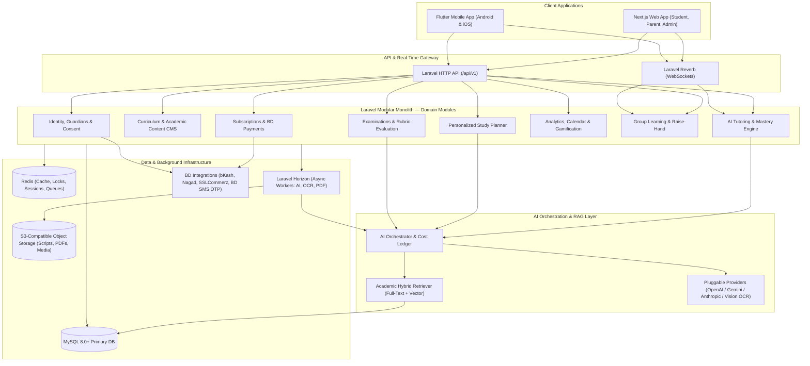

# System Architecture Document

## 1. Architectural Philosophy: Modular Monolith First

**AI Home Tutor Bangladesh** is architected as a **Modular Monolith** powered by **Laravel 11+** on the backend, serving two independent frontends (**Next.js App Router** for Web and **Flutter** for Android/iOS) over a versioned, OpenAPI-documented REST API (`/api/v1`) and WebSockets (**Laravel Reverb**).

### Why a Modular Monolith?
1. **Strict Domain Boundaries without Distributed Tax**: Each domain module (`Curriculum`, `Tutoring`, `StudyPlanner`, `Examinations`, `Evaluation`, `LearningAnalytics`, `Subscriptions`, etc.) is isolated inside its own namespace with explicit service contracts.
2. **ACID Transactional Integrity**: Updating an examination attempt, recording rubric evaluation scores, recalculating objective mastery, and awarding gamification XP can execute reliably inside coordinated database transactions and domain events.
3. **Operational Simplicity**: One backend codebase, unified CI/CD pipeline, shared authentication/authorization policies, and zero inter-service network serialization overhead during Phase 1–5.
4. **Extraction-Ready**: Because all AI calls, OCR jobs, and third-party gateways sit behind strict PHP interfaces and Redis queues, heavy compute workers (e.g., handwritten script OCR or vector embedding pipelines) can be scaled independently or extracted into standalone services later without rewriting domain logic.

---

## 2. High-Level System Topology

---

## 3. Core Infrastructure Components

### 3.1 Primary Relational Database (`MySQL 8.0+`)
- Stores all transactional, relational, and historical records: users, guardians, consent records, versioned curriculum hierarchies, question banks, rubrics, study plans, tutoring sessions, exam attempts, mastery scores, and billing ledgers.
- Uses strict foreign keys, composite indexes for tenant/student scoping, and UTF-8 (`utf8mb4_unicode_ci`) encoding for seamless Bangla Unicode and mathematical notation storage.

### 3.2 In-Memory Data Store (`Redis 7+`)
- **Active Tutoring Session State Cache**: Caches the current finite-state machine context (`lesson_stage`, recent turn summary, active objective) for sub-50ms state lookups.
- **Rate Limiting & Token Quotas**: Enforces per-student daily AI turn limits and per-IP OTP throttling.
- **Idempotency Locks**: Prevents duplicate exam submissions, double AI turn generation, and duplicate payment webhook processing (`Cache::lock(...)`).
- **Queue Broker**: Backs Laravel Horizon job queues.

### 3.3 Asynchronous Processing (`Laravel Queue + Horizon`)
Queues are partitioned by workload priority and timeout profile:
1. `high-realtime`: Quick post-turn mastery updates, real-time notifications (`timeout: 15s`).
2. `ai-evaluation`: Typed short-answer and creative question (*সৃজনশীল*) rubric grading (`timeout: 90s`).
3. `ocr-vision`: Handwritten answer script preprocessing, Bangla/Math OCR extraction, and multi-page rubric evaluation (`timeout: 180s`).
4. `documents-pdf`: Watermarked chapter note PDFs, exam admit/result sheets, and weekly parent report PDFs (`timeout: 60s`).
5. `notifications-sms`: Transactional BD SMS OTPs, guardian consent invites, and weekly summary dispatches (`timeout: 30s`).

### 3.4 Real-Time Communication (`Laravel Reverb`)
- Powers WebSocket channels for:
  - **AI Tutor Streaming / State Transitions**: `private-tutor.session.{sessionId}`
  - **Examination Live Status & Timer Sync**: `private-exam.attempt.{attemptId}`
  - **Group Study & Raise-Hand Queue**: `presence-group.session.{groupSessionId}`
  - **Async Script Evaluation Completion**: `private-student.{studentId}`

### 3.5 Object Storage (`S3-Compatible Storage`)
- **Public Read / CDN-Backed Bucket**: Approved textbook diagrams, SVG geometric illustrations, badge icons.
- **Private Encrypted Bucket (Signed URLs Only)**: Student handwritten answer script photos, generated personal academic report PDFs, and consent audit exports.

### 3.6 Hybrid Academic Search & RAG Store
- Combines **MySQL Full-Text Search** (for exact Bangla/English keyword and textbook definition matching) with **Vector Embeddings** (stored in a dedicated vector index such as `Qdrant`, `pgvector`, or `Meilisearch` vector store, synced automatically when content is marked `Published`).
- Every indexed chunk carries strict metadata filters: `curriculum_version_id`, `class_id`, `subject_id`, `chapter_id`, `topic_id`, `learning_objective_id`, and `content_type`.

---

## 4. Bangladesh-Specific Integrations

### 4.1 Payment Gateways (`PaymentGatewayInterface`)
Supports local mobile financial services (MFS) and cards via a unified adapter pattern:
1. **bKash Tokenized Checkout**: Supports one-time package purchases and tokenized recurring subscription renewals.
2. **Nagad Merchant Checkout**: Direct MFS checkout for guardian subscriptions.
3. **SSLCommerz**: Unified aggregator supporting Visa/Mastercard, local debit cards, and internet banking.
- **Webhook Security**: All payment callbacks verify HMAC signatures, check transaction status directly against the gateway's verification API, and execute inside an idempotent database transaction updating `payments` and `subscriptions`.

### 4.2 Local SMS OTP & Notification Gateway (`SmsGatewayInterface`)
- Integrates with local BTRC-compliant masking/non-masking SMS aggregators (e.g., SSL Wireless, GreenWeb, BoomCast) with automatic failover.
- Used for:
  - Student & Guardian OTP authentication.
  - Guardian Child-Consent verification links (PDPA 2026 compliance).
  - Weekly parent academic summary SMS alerts.

---

## 5. Cross-Cutting Non-Functional Requirements

| Dimension | Architectural Standard |
| :--- | :--- |
| **Latency** | Standard API reads `< 150ms` (p95); AI Tutor first token / structured response `< 2.5s` (p95). |
| **Low-Bandwidth Resilience** | Compressed JSON payloads (Brotli/Gzip), WebP/SVG diagrams, delta sync for mobile study plans, and resumable chunked uploads for handwritten scripts. |
| **Multi-Tenant Student Isolation** | Every student-owned query is scoped via Eloquent Global/Local Scopes and verified by `StudentOwnershipPolicy` (allowing only the student or a verified linked guardian with active consent). |
| **Observability** | Structured JSON logs with `correlation_id`, Laravel Horizon metrics, Sentry error tracking, and real-time `ai_usage_logs` cost dashboards. |

