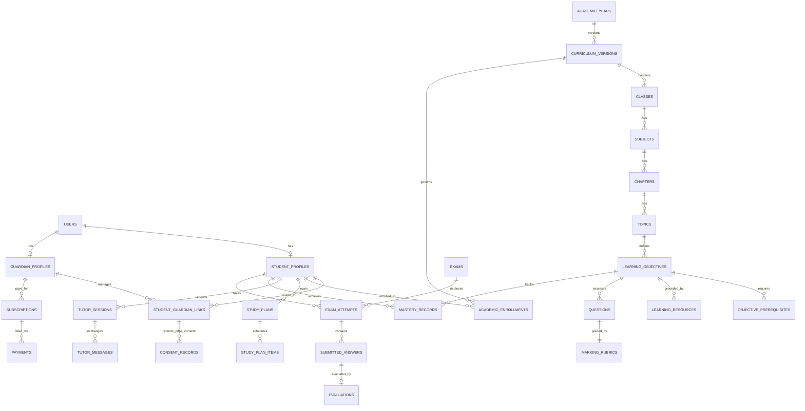

# Database Design & Entity-Relationship Specification

This document defines the relational database schema (`MySQL 8.0+`, `utf8mb4_unicode_ci`) for **AI Home Tutor Bangladesh**, covering all domain modules, key relationships, JSON structures, and indexing rules.

---

## 1. Three Non-Negotiable Database Rules

1. **Historical Academic Data Must Be Preserved**:
   - Curriculum versions (`curriculum_versions`) are immutable once `status = 'published'`.
   - When NCTB updates a syllabus (e.g., 2026 vs. 2027), a new `curriculum_version` row is created. Existing `academic_enrollments`, `tutor_sessions`, `exam_attempts`, and `mastery_records` remain permanently bound to the `curriculum_version_id` under which they were recorded. Never `CASCADE DELETE` or overwrite historical curriculum entities.
2. **Learning Progress Must Be Evidence-Based**:
   - `mastery_records` are tied to granular `learning_objectives` and updated solely via immutable `mastery_evidence_logs` linked to verified assessments (`tutor_messages`, `exam_attempts`, `evaluations`), never from content pageviews.
3. **All Student Data Must Be Strictly Scoped**:
   - Every student-owned table includes an indexed `student_id` foreign key. Cross-student queries are blocked at the application policy layer and audited via `admin_audit_logs`.

---

## 2. Core Entity-Relationship Diagram (ERD)

---

## 3. Detailed Domain Schema Specifications

### 3.1 Identity, Guardians, Students & PDPA 2026 Consent

#### `users`
| Column | Type | Constraints | Description |
| :--- | :--- | :--- | :--- |
| `id` | `BIGINT UNSIGNED` | `PK, AUTO_INCREMENT` | Primary key |
| `uuid` | `CHAR(36)` | `UNIQUE, NOT NULL` | Public identifier exposed in APIs |
| `name_bn` | `VARCHAR(150)` | `NULLABLE` | Full name in Bangla |
| `name_en` | `VARCHAR(150)` | `NOT NULL` | Full name in English |
| `phone` | `VARCHAR(20)` | `UNIQUE, NOT NULL` | Normalized BD mobile (`+8801XXXXXXXXX`) |
| `email` | `VARCHAR(191)` | `UNIQUE, NULLABLE` | Optional email address |
| `password` | `VARCHAR(255)` | `NULLABLE` | Bcrypt/Argon2id hash (nullable for OTP-only accounts) |
| `account_type` | `ENUM` | `NOT NULL` | `student`, `guardian`, `teacher`, `reviewer`, `admin` |
| `status` | `ENUM` | `DEFAULT 'active'` | `pending_consent`, `active`, `suspended`, `deleted` |
| `phone_verified_at` | `TIMESTAMP` | `NULLABLE` | OTP verification timestamp |
| `created_at` / `updated_at` | `TIMESTAMP` | | |

#### `student_profiles`
| Column | Type | Constraints | Description |
| :--- | :--- | :--- | :--- |
| `id` | `BIGINT UNSIGNED` | `PK` | |
| `user_id` | `BIGINT UNSIGNED` | `FK -> users.id, UNIQUE` | |
| `student_code` | `VARCHAR(24)` | `UNIQUE, NOT NULL` | Human-readable ID (e.g., `STD-2026-004812`) |
| `current_class_level` | `TINYINT UNSIGNED` | `NOT NULL, INDEX` | Grade `1` to `10` (MVP: `6`, `7`, `8`) |
| `medium` | `ENUM` | `DEFAULT 'bangla'` | `bangla`, `english_version`, `english_medium`, `madrasa` |
| `school_name` | `VARCHAR(200)` | `NULLABLE` | Student's school in Bangladesh |
| `district` | `VARCHAR(80)` | `NULLABLE` | BD District |
| `date_of_birth` | `DATE` | `NULLABLE` | Used for age-cohort and minor verification |
| `consent_status` | `ENUM` | `DEFAULT 'pending'` | `pending`, `verified`, `withdrawn` |
| `daily_study_target_mins` | `SMALLINT UNSIGNED` | `DEFAULT 60` | Default daily study target |
| `pseudonym` | `VARCHAR(80)` | `NULLABLE` | Opt-in leaderboard display handle |

#### `guardian_profiles`, `student_guardian_links` & `consent_records`
- **`guardian_profiles`**: `id`, `user_id (FK)`, `relation_type` (`father`, `mother`, `legal_guardian`), `preferred_language` (`bn`, `en`), `weekly_report_channel` (`sms`, `whatsapp`, `email`, `push`).
- **`student_guardian_links`**: `id`, `student_id (FK)`, `guardian_id (FK)`, `is_primary_payer (BOOL)`, `status` (`invited`, `verified`, `revoked`), `verified_at`. Unique index on `(student_id, guardian_id)`.
- **`consent_records` (PDPA 2026 Compliance)**:
  - `id`, `student_id (FK)`, `guardian_id (FK)`, `policy_version` (e.g., `PDPA-2026-v1`), `consent_scope_json` (`{"ai_tutoring": true, "handwritten_ocr": true, "group_study": false}`), `verification_method` (`otp_sms`, `signed_form`), `ip_address`, `user_agent`, `consented_at`, `withdrawn_at`.

---

### 3.2 Curriculum Hierarchy & Academic Content CMS

#### `academic_years` & `curriculum_versions`
- **`academic_years`**: `id`, `year_code` (`2026`, `2027`), `title_bn` (`শিক্ষাবর্ষ ২০২৬`), `starts_on`, `ends_on`, `is_current (BOOL)`.
- **`curriculum_versions`**:
  - `id`, `academic_year_id (FK)`, `version_code` (`NCTB-2026-BM-v1.0`), `board` (`NCTB`), `medium` (`bangla`), `status` (`draft`, `published`, `archived`), `effective_from`, `effective_to`, `changelog_notes`, `published_by (FK -> users.id)`, `published_at`.

#### `classes`, `subjects`, `chapters`, `topics`
- **`classes`**: `id`, `curriculum_version_id (FK)`, `grade_level` (`1`–`10`), `education_stage` (`primary`, `lower_secondary`, `secondary`), `title_bn` (`অষ্টম শ্রেণি`), `title_en` (`Class 8`), `teaching_persona_config (JSON)`.
- **`subjects`**: `id`, `class_id (FK)`, `nctb_subject_code` (`109`), `title_bn` (`গণিত`), `title_en` (`Mathematics`), `slug`, `exam_structure_json` (mark distribution across MCQ, Creative, Practical), `sort_order`, `is_active`.
- **`chapters`**: `id`, `subject_id (FK)`, `chapter_number` (`4`), `title_bn` (`বীজগণিতীয় সূত্রাবলি ও প্রয়োগ`), `title_en` (`Algebraic Formulas and Applications`), `syllabus_status` (`included`, `excluded_for_short_syllabus`), `estimated_study_minutes`, `sort_order`.
- **`topics`**: `id`, `chapter_id (FK)`, `topic_number` (`4.1`), `title_bn`, `title_en`, `estimated_minutes`, `difficulty_level` (`easy`, `medium`, `hard`), `sort_order`.

#### `learning_objectives` & `objective_prerequisites`
- **`learning_objectives`**:
  - `id`, `topic_id (FK)`, `code` (`C8-MATH-CH4-T1-LO1`), `title_bn`, `title_en`, `bloom_level` (`knowledge`, `comprehension`, `application`, `higher_order`), `mastery_threshold_pct` (`DEFAULT 75`), `sort_order`.
- **`objective_prerequisites`**:
  - `id`, `learning_objective_id (FK)`, `prerequisite_objective_id (FK)`, `is_strict (BOOL)`. Unique index on `(learning_objective_id, prerequisite_objective_id)`.

#### `learning_resources` (CMS + RAG Grounding Chunks)
| Column | Type | Constraints | Description |
| :--- | :--- | :--- | :--- |
| `id` | `BIGINT UNSIGNED` | `PK` | |
| `curriculum_version_id` | `BIGINT UNSIGNED` | `FK, INDEX` | |
| `chapter_id` | `BIGINT UNSIGNED` | `FK, INDEX` | |
| `topic_id` | `BIGINT UNSIGNED` | `FK, NULLABLE, INDEX` | |
| `learning_objective_id` | `BIGINT UNSIGNED` | `FK, NULLABLE, INDEX` | |
| `resource_type` | `ENUM` | `NOT NULL` | `lesson_note`, `summary`, `definition`, `worked_example`, `diagram`, `formula_sheet` |
| `title_bn` | `VARCHAR(255)` | `NOT NULL` | |
| `content_markdown` | `LONGTEXT` | `NOT NULL` | Bangla/English markdown with `$...$` KaTeX math |
| `media_assets_json` | `JSON` | `NULLABLE` | S3 URLs, alt text, diagram labels |
| `nctb_page_reference` | `VARCHAR(60)` | `NULLABLE` | Official textbook page reference (e.g., `পৃষ্ঠা ৪৭–৪৯`) |
| `workflow_status` | `ENUM` | `DEFAULT 'draft'` | `draft`, `in_review`, `approved`, `published`, `archived` |
| `reviewed_by` | `BIGINT UNSIGNED` | `FK -> users.id, NULLABLE` | |
| `vector_embedding_id` | `VARCHAR(100)` | `NULLABLE` | External vector store ID once published |

---

### 3.3 AI Tutoring Engine & Evidence-Based Mastery

#### `tutor_sessions`
| Column | Type | Constraints | Description |
| :--- | :--- | :--- | :--- |
| `id` | `BIGINT UNSIGNED` | `PK` | |
| `uuid` | `CHAR(36)` | `UNIQUE, NOT NULL` | |
| `student_id` | `BIGINT UNSIGNED` | `FK -> student_profiles.id, INDEX` | |
| `curriculum_version_id` | `BIGINT UNSIGNED` | `FK` | |
| `topic_id` | `BIGINT UNSIGNED` | `FK` | |
| `active_objective_id` | `BIGINT UNSIGNED` | `FK -> learning_objectives.id` | |
| `current_stage` | `ENUM` | `NOT NULL` | `START_LESSON`, `CHECK_PREREQUISITES`, `TEACH_PREREQUISITE`, `EXPLAIN_CONCEPT`, `WORKED_EXAMPLE`, `ASK_STUDENT_QUESTION`, `IDENTIFY_MISCONCEPTION`, `EXPLAIN_CORRECTION`, `ASK_SIMILAR_QUESTION`, `INCREASE_DIFFICULTY`, `MINI_ASSESSMENT`, `SAVE_LEARNING_PROGRESS`, `COMPLETED` |
| `session_status` | `ENUM` | `DEFAULT 'active'` | `active`, `paused`, `completed`, `abandoned` |
| `compact_summary_text` | `TEXT` | `NULLABLE` | Rolling conversation summary for token optimization |
| `state_metadata_json` | `JSON` | `NOT NULL` | Tracks consecutive correct answers, hints used, mini-quiz score |
| `active_duration_seconds` | `INT UNSIGNED` | `DEFAULT 0` | Verified active time |
| `started_at` / `completed_at` | `TIMESTAMP` | | |

#### `tutor_messages`
- `id`, `tutor_session_id (FK)`, `client_turn_id (CHAR(36), UNIQUE)` (for mobile retry idempotency), `sender_role` (`tutor`, `student`, `system`), `lesson_stage`, `student_action_type` (`text_reply`, `simplify`, `example`, `hint`, `previous_step`), `structured_payload_json` (matches `TutorResponseSchema`), `is_answer_correct (BOOL, NULLABLE)`, `misconception_code (VARCHAR, NULLABLE)`, `hints_used_count (TINYINT)`, `ai_request_id (FK -> ai_requests.id, NULLABLE)`, `created_at`.

#### `mastery_records` & `mastery_evidence_logs`
- **`mastery_records`**:
  - `id`, `student_id (FK)`, `curriculum_version_id (FK)`, `learning_objective_id (FK)`, `mastery_score` (`DECIMAL(5,2)`, `0.00` to `100.00`), `mastery_status` (`unstarted`, `struggling`, `practicing`, `proficient`, `mastered`), `attempts_count`, `correct_count`, `last_assessed_at`, `next_review_due_at`.
  - **Composite Unique Index**: `UNIQUE (student_id, curriculum_version_id, learning_objective_id)`.
- **`mastery_evidence_logs`**:
  - `id`, `mastery_record_id (FK)`, `student_id (FK)`, `source_type` (`prerequisite_check`, `guided_practice`, `mini_assessment`, `chapter_exam`, `model_exam`), `source_id`, `question_difficulty` (`easy`, `medium`, `hard`), `score_ratio` (`DECIMAL(4,3)`), `hints_used`, `previous_mastery`, `new_mastery`, `recorded_at`.

---

### 3.4 Personalized Study Planner & Calendar

- **`study_plans`**: `id`, `student_id (FK)`, `curriculum_version_id (FK)`, `title`, `target_completion_date`, `daily_study_minutes`, `status` (`active`, `completed`, `archived`), `completion_percentage`, `config_json` (selected chapter IDs, exam date).
- **`study_plan_items` (Learning Tasks)**:
  - `id`, `study_plan_id (FK)`, `student_id (FK, INDEX)`, `subject_id (FK)`, `chapter_id (FK)`, `topic_id (FK, NULLABLE)`, `learning_objective_id (FK, NULLABLE)`, `task_type` (`concept_lesson`, `prerequisite_remedial`, `guided_practice`, `revision`, `chapter_quiz`), `scheduled_date (DATE, INDEX)`, `planned_minutes`, `actual_active_minutes`, `status` (`scheduled`, `in_progress`, `completed`, `overdue`, `rescheduled`), `rescheduled_from_date (DATE, NULLABLE)`, `completed_at`.
- **`study_time_logs`**:
  - `id`, `student_id (FK)`, `study_date (DATE)`, `subject_id (FK)`, `source_type` (`tutor_session`, `exam_attempt`, `resource_study`), `source_id`, `session_start_at`, `session_end_at`, `active_seconds`, `paused_seconds`, `questions_attempted`.

---

### 3.5 Question Bank, Examinations & Rubric Evaluation

#### `questions` & `marking_rubrics`
- **`questions`**:
  - `id`, `uuid`, `curriculum_version_id (FK)`, `subject_id (FK)`, `chapter_id (FK)`, `topic_id (FK)`, `learning_objective_id (FK)`, `question_type` (`mcq_single`, `mcq_multi_statement`, `short_answer`, `fill_blank`, `true_false`, `math_problem`, `creative_srijonshil`, `descriptive`), `difficulty` (`easy`, `medium`, `hard`), `marks` (`DECIMAL(4,2)`), `stem_markdown` (Bangla/Math stem or *উদ্দীপক*), `options_json` (for MCQs), `sub_questions_json` (for *সৃজনশীল ক, খ, গ, ঘ*), `deterministic_answer_key_json`, `status` (`draft`, `approved`, `published`).
- **`marking_rubrics`**:
  - `id`, `question_id (FK, UNIQUE)`, `expected_answer_markdown`, `step_wise_marks_json` (array of steps, criteria, and allocated marks), `required_points_json`, `accepted_alternatives_json` (equivalent math forms or synonyms), `common_mistakes_json` (mapped to misconception codes), `nctb_reference`.

#### `exams`, `exam_attempts`, `submitted_answers` & `evaluations`
- **`exams`**: `id`, `uuid`, `curriculum_version_id (FK)`, `subject_id (FK)`, `created_by_student_id (NULLABLE)`, `exam_type` (`chapter`, `subject`, `model_board`), `title_bn`, `duration_minutes`, `total_marks`, `question_blueprint_json`.
- **`exam_attempts`**: `id`, `uuid`, `exam_id (FK)`, `student_id (FK, INDEX)`, `status` (`in_progress`, `submitted`, `evaluating`, `provisional_graded`, `final_graded`), `started_at`, `expires_at`, `submitted_at`, `obtained_marks`, `percentage_score`.
- **`submitted_answers`**: `id`, `exam_attempt_id (FK)`, `question_id (FK)`, `answer_mode` (`mcq_choice`, `typed_text`, `handwritten_upload`), `selected_option_key`, `typed_answer_text`, `is_flagged_for_review (BOOL)`, `time_spent_seconds`.
- **`script_uploads`**: `id`, `exam_attempt_id (FK)`, `student_id (FK)`, `s3_object_key`, `page_number`, `image_quality_score`, `ocr_status` (`queued`, `processing`, `completed`, `failed`), `ocr_extracted_json` (recognized Bangla/Math text + bounding boxes + confidence), `student_corrected_text`.
- **`evaluations`**:
  - `id`, `submitted_answer_id (FK, UNIQUE)`, `evaluator_type` (`deterministic`, `ai_rubric`, `human_reviewer`), `marks_awarded`, `max_marks`, `confidence_score` (`DECIMAL(4,3)`), `review_status` (`auto_approved`, `provisional`, `flagged_for_human`, `human_verified`), `step_breakdown_json` (marks per rubric step, missing points, calculation errors), `feedback_bn`, `nctb_citation`, `reviewed_by_user_id (NULLABLE)`.

---

### 3.6 Subscriptions, BD Payments & AI Usage Ledger

- **`subscription_plans`**: `id`, `code` (`free`, `basic_monthly`, `premium_monthly`, `family_monthly`), `name_bn`, `price_bdt`, `billing_cycle_days`, `max_children`, `daily_ai_turns_quota`, `monthly_script_ocr_quota`, `features_json`.
- **`subscriptions`**: `id`, `guardian_id (FK)`, `student_id (FK, NULLABLE)`, `plan_id (FK)`, `status` (`trial`, `active`, `past_due`, `cancelled`, `expired`), `starts_at`, `ends_at`, `auto_renew (BOOL)`.
- **`payments`**: `id`, `uuid`, `subscription_id (FK)`, `guardian_id (FK)`, `gateway` (`bkash`, `nagad`, `sslcommerz`), `gateway_transaction_id (UNIQUE)`, `idempotency_key (UNIQUE)`, `amount_bdt`, `currency` (`BDT`), `status` (`initiated`, `completed`, `failed`, `refunded`), `gateway_payload_json`, `paid_at`.
- **`ai_requests` & `usage_ledger`**:
  - `id`, `student_id (FK)`, `subscription_id (FK, NULLABLE)`, `ai_service` (`tutor_engine`, `study_planner`, `question_gen`, `answer_evaluator`, `handwriting_ocr`), `provider` (`openai`, `gemini`, `anthropic`), `model_name`, `prompt_version_id (FK)`, `input_tokens`, `output_tokens`, `estimated_cost_usd` (`DECIMAL(10,6)`), `estimated_cost_bdt` (`DECIMAL(10,4)`), `latency_ms`, `status`, `created_at`.

