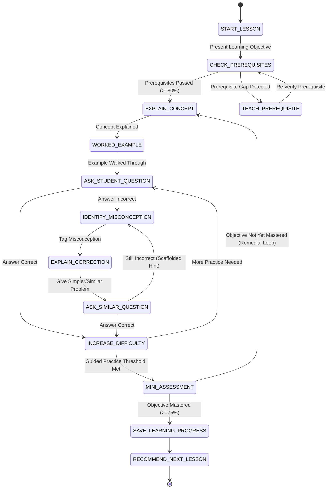

# Product Requirements Document (PRD) & Feature Specifications

This document provides the complete functional specification, business rules, user journeys, and acceptance criteria across all **12 Product Modules** of **AI Home Tutor Bangladesh**, with deep specifications for **Curriculum Management** and the **AI Private Tutor Engine**.

---

## Module 01 — Authentication, Student Profiles & Guardian Linking

### 1.1 Overview
A Bangladesh-first registration, authentication, and family account-linking system designed for students (Classes 1–10) and their parents/guardians, compliant with the **Bangladesh Personal Data Protection Act, 2026 (Act No. 63 of 2026)**.

### 1.2 Functional Requirements
1. **Account Types**:
   - `student`: Accesses learning dashboard, AI tutor, study plans, examinations, study materials, and personal progress.
   - `guardian`: Manages 1 to $N$ linked children, provides legal data-processing consent, monitors academic reports, and manages subscriptions/payments.
   - `teacher` (Phase 6): Manages live classes, batch assignments, and human script evaluation.
   - `content_reviewer` / `admin`: Manages NCTB curriculum versions, academic content, question banks, rubrics, and AI quality audits.
2. **Registration & Login Flows**:
   - **Mobile Number + OTP / Password**: Primary login method using Bangladeshi mobile numbers (`+8801XXXXXXXXX`) via local BD SMS gateway, plus optional password and email.
   - **Student Onboarding Fields**: Full Name (Bangla & English), Mobile Number, Class (6–8 initially, schema supports 1–10), Academic Year (e.g., `2026`), Medium (`bangla`), School Name (optional), District/Division, and Guardian Mobile Number.
3. **Guardian Linking & PDPA 2026 Consent Workflow**:
   - When a minor student registers, an SMS invite/OTP link is dispatched to the Guardian's mobile number, **or** a Guardian registers first and creates child profiles directly.
   - Guardian must explicitly accept the **Child Data & AI Processing Consent Agreement**, creating an immutable `consent_records` entry (timestamp, IP, policy version, guardian ID, student ID).
   - Guardians can switch seamlessly between multiple linked children from a unified Parent Switcher without sharing passwords.

### 1.3 Acceptance Criteria
- [ ] Phone numbers validate strictly against BD operator prefixes (`013`–`019`).
- [ ] Unconsented minor student accounts are restricted to a sandbox preview until guardian OTP consent is completed.
- [ ] A single Guardian account can link and switch between at least 5 Student profiles with strict authorization policies (`GuardianPolicy`).

---

## Module 02 — AI Private Tutor (Deep Specification)

### 2.1 Overview
The core product module: a **stateful pedagogical conversation engine** that teaches NCTB topics step by step in age-appropriate Bangla, verifies prerequisites, diagnoses misconceptions, guides practice with progressive hints, and assesses mastery before completing a lesson.

### 2.2 Pedagogical State Machine
Every tutoring session (`tutor_sessions`) executes an explicit finite state machine controlled by the Laravel backend:

### 2.3 Detailed 7-Step Lesson Walkthrough (Example: Class 8 Math — বীজগণিতের রাশি)
1. **Step 1 — Welcome & Learning Objective (`START_LESSON`)**:
   - Introduces the topic in encouraging, age-appropriate Bangla:
     *"আজ আমরা বীজগণিতের রাশি সম্পর্কে শিখব। এই পাঠ শেষে তুমি নিজে থেকে বীজগাণিতিক রাশি তৈরি করতে পারবে এবং সেগুলো সরল করতে পারবে।"*
2. **Step 2 — Prerequisite Check (`CHECK_PREREQUISITES`)**:
   - Queries linked prerequisite `learning_objectives` from the curriculum graph.
   - Asks 2–3 diagnostic micro-questions (e.g., *"যদি $x = 5$ হয়, তাহলে $x + 3$ এর মান কত?"*).
   - If the student fails, transitions to `TEACH_PREREQUISITE` for a concise refresher before starting the main topic.
3. **Step 3 — Concept Explanation & Worked Examples (`EXPLAIN_CONCEPT` → `WORKED_EXAMPLE`)**:
   - Grounds explanation strictly in approved NCTB lesson blocks retrieved via RAG.
   - Uses everyday Bangladeshi examples, textbook-aligned definitions, KaTeX mathematical expressions, and visual diagrams.
4. **Step 4 — Interactive Questioning & Misconception Diagnosis (`ASK_STUDENT_QUESTION` → `IDENTIFY_MISCONCEPTION`)**:
   - Poses an interactive problem: $3x + 2x = ?$
   - If student answers $5x^2$, the AI identifies the exact misconception (*exponent addition instead of coefficient addition for like terms*):
     *"তুমি এখানে $x$-এর ঘাত বাড়িয়ে দিয়েছ। কিন্তু $3x$ এবং $2x$ একই ধরনের পদ (সদৃশ পদ)। তাই তাদের সহগ যোগ করতে হবে। চলো আরেকটি সহজ উদাহরণ দিয়ে দেখি।"*
5. **Step 5 — Guided Practice with Fading Hints (`ASK_SIMILAR_QUESTION` → `INCREASE_DIFFICULTY`)**:
   - Provides progressive 3-level hints (`Hint 1: Conceptual Nudge`, `Hint 2: Formula/Rule Reminder`, `Hint 3: First Step Shown`) only when requested or after an error, gradually fading scaffolding until the student solves 2–3 problems unassisted.
6. **Step 6 — Mini Assessment (`MINI_ASSESSMENT`)**:
   - Presents 3–5 unassisted verification questions mapped to the session's `learning_objective_id`. Hints are disabled during `MINI_ASSESSMENT`.
7. **Step 7 — Lesson Completion & Evidence Recording (`SAVE_LEARNING_PROGRESS`)**:
   - Records topics covered, questions attempted, accuracy, hints used, active duration, and updates `mastery_records`. Recommends the next topic or remedial practice.

### 2.4 Class-Level Teaching Personas
| Class Cohort | Tone & Pedagogical Style |
| :--- | :--- |
| **Classes 1–2** | Very simple Bangla sentences, storytelling, visual illustrations, tiny 1-step questions, warm praise. |
| **Classes 3–5** | Short clear paragraphs, relatable daily-life examples, interactive check-ins every 2–3 minutes. |
| **Classes 6–8 (MVP Target)** | Conceptual clarity, logical "why" behind formulas, step-by-step problem solving, misconception diagnosis. |
| **Classes 9–10** | Rigorous analytical reasoning, multi-step proofs, NCTB board-exam (*সৃজনশীল*) structuring, mark-distribution awareness. |

### 2.5 Student Controls During a Session
Students have persistent UI action controls (not just free-text typing) to:
- **"আরেকটু সহজ করে বোঝাও"** (Explain more simply)
- **"আরেকটি উদাহরণ দাও"** (Give another example)
- **"ইঙ্গিত দাও (Hint)"** (Request a progressive hint)
- **"আগের অংশে ফিরে যাও"** (Return to previous concept)
- **"পাঠ বিরতি (Pause & Resume)"** (Save exact state and resume later from web or mobile)

### 2.6 Acceptance Criteria
- [ ] AI Tutor never advances from `EXPLAIN_CONCEPT` to `MINI_ASSESSMENT` without the student answering guided practice questions.
- [ ] Every tutor turn returns validated JSON matching the `TutorResponseSchema` (never raw unvalidated markdown blobs).
- [ ] Pausing a lesson on Web and opening the Mobile app resumes at the exact `lesson_stage` and conversation turn.

---

## Module 03 — Personalized Study Planner

### 3.1 Functional Requirements
1. **Plan Configuration Inputs**:
   - Class & Active Curriculum Version (auto-detected from profile).
   - Subject(s) and selected Chapter(s) (e.g., Class 8 Math: *বীজগণিত*, *সরল সমীকরণ*, *জ্যামিতি*).
   - Target Completion Date or upcoming School Examination Date.
   - Daily Available Study Time (e.g., 45 mins/day on weekdays, 90 mins/day on weekends).
2. **Deterministic Backend Scheduling + AI Sequencing**:
   - The backend `StudyPlanGeneratorService` calculates total required learning minutes based on:
     - Number of unmastered `learning_objectives` in selected chapters.
     - Missing prerequisite objectives across earlier chapters.
     - Student's current mastery score per objective (e.g., skips basic explanations if mastery $\ge 80\%$ and schedules quick verification; allocates 1.5x time if mastery $< 40\%$).
     - Mandatory spaced-revision slots and chapter-end assessment buffers.
3. **Dynamic Adaptation & Rescheduling**:
   - If a student fails a `MINI_ASSESSMENT` or misses scheduled tasks:
     - Weak objectives are automatically inserted into the **Remedial Revision Queue**.
     - Upcoming tasks rebalance across remaining available days.
     - If the target completion date becomes mathematically infeasible given daily time limits, the system alerts the student and guardian with options to extend the target date or increase daily study minutes.
   - Rescheduling a task marks the prior slot as `rescheduled` without deleting historical adherence records.

---

## Module 04 — Study Materials & Learning Resources

### 4.1 Content Types per Chapter & Topic
Every NCTB chapter and topic contains version-controlled, reviewer-approved resources:
1. **Lesson Notes (*পাঠ নোট*)**: Structured, textbook-aligned explanations.
2. **Chapter Summary (*অধ্যায় সারসংক্ষেপ*)**: Quick-revision bullet points.
3. **Key Definitions (*সংজ্ঞা ও ধারণা*)**: Official NCTB phrasing for 1-mark (*জ্ঞানমূলক*) questions.
4. **Worked Examples (*সমাধানকৃত উদাহরণ*)**: Step-by-step solutions with annotations.
5. **Diagrams & Visuals (*চিত্র ও ডায়াগ্রাম*)**: Labeled scientific diagrams and geometric figures.
6. **Formula Sheets (*সূত্রাবলি*)**: KaTeX-rendered mathematical and scientific formulas.
7. **Topic-wise Practice Bank**: Categorized into MCQ, Short Answer, Problem Solving, and Creative Questions (*সৃজনশীল প্রশ্ন*: ক - জ্ঞানমূলক, খ - অনুধাবনমূলক, গ - প্রয়োগমূলক, ঘ - উচ্চতর দক্ষতামূলক).

### 4.2 Student Resource Tools
- Bookmark resources, highlight text passages, attach personal margin notes, full-text search within a chapter (Bangla & English), and download clean watermarked PDFs for offline reading.

---

## Module 05 — Examination System & Answer Script Evaluation

### 5.1 Examination Types
1. **Chapter-wise Examinations**: Custom or preset test on 1+ selected chapters.
2. **Subject-wise Examinations**: Mid-term or term-level multi-chapter assessment.
3. **Model Examinations**: Full timed simulation matching official NCTB syllabus, question pattern, and mark distribution (e.g., Part A: MCQ, Part B: Creative Questions / *সৃজনশীল* where student answers $k$ out of $n$ stems).

### 5.2 Supported Question Formats
- Multiple Choice Questions (MCQ — standard 4-option & NCTB multi-statement *বহুপদী সমাপ্তিসূচক* / *অভিন্ন তথ্যভিত্তিক*).
- Short Questions (*সংক্ষিপ্ত প্রশ্ন*), Fill in the Blanks, True/False, Matching.
- Mathematical Problem Solving (step-by-step symbolic/numeric).
- Creative Questions (*সৃজনশীল প্রশ্ন — উদ্দীপক + ক, খ, গ, ঘ*).
- Descriptive / Diagram-based / Grammar & Composition questions.

### 5.3 Live Exam Interface Requirements
- Server-synchronized countdown timer with graceful offline buffer.
- Question palette showing `Answered`, `Unanswered`, `Flagged for Review`, and `Current`.
- Background auto-save on every answer selection/keystroke (idempotent `/api/v1/attempts/{id}/autosave`).
- Automatic submission upon timer expiry.

### 5.4 Written & Handwritten Answer Script Evaluation Pipeline (Phase 3 Typed → Phase 5 Handwritten OCR)
1. **Typed Written Evaluation (Phase 3)**:
   - Students type Bangla/English/Math answers directly; evaluated against the question's `MarkingRubric`.
2. **Handwritten Script Upload & Evaluation (Phase 5)**:
   - Student photographs/scans handwritten pages via mobile camera or web upload.
   - **Step 1 — Image Validation**: Checks blur, lighting, orientation, and page ordering.
   - **Step 2 — Preprocessing**: Deskewing, contrast enhancement, page segmentation.
   - **Step 3 — Handwriting & Math OCR**: Multimodal vision extraction for Bangla handwriting, English text, and mathematical equations (converted to LaTeX) with per-block confidence scores ($0.0 - 1.0$). Student can review/correct recognized text before final grading if desired.
   - **Step 4 — Question-to-Answer Mapping**: Maps script regions to Question numbers (e.g., `১ নং প্রশ্নের উত্তর (গ)`).
   - **Step 5 — Rubric-Based Evaluation**: Compares student steps against `MarkingRubric` (expected points, step-wise marks, accepted alternative methods, common mistakes).
   - **Step 6 — Confidence Gate**:
     - If OCR confidence $\ge 0.85$ and rubric evaluation confidence $\ge 0.80$ $\rightarrow$ Generates **Provisional Result** immediately with line-by-line feedback, missing points, calculation error highlights, and NCTB textbook page citations.
     - If confidence $<$ threshold $\rightarrow$ Flags for **Manual Reviewer / Recheck Queue**.

---

## Module 06 — Learning Calendar & Activity Tracking

### 6.1 Task Lifecycle & Views
- **Views**: Daily Agenda, Weekly Calendar, Monthly Overview, Subject-wise Filter.
- **Task Statuses**: `scheduled`, `in_progress`, `completed`, `overdue`, `rescheduled`.

### 6.2 Accurate Active Study Time Tracking
- Study time is **never** calculated as `logout_time - login_time`.
- The client sends heartbeat pings every 30 seconds only during active interaction (scrolling, typing, answering, audio/tutor interaction).
- Inactivity $> 120$ seconds transitions the session timer to `paused_duration`.
- Logs exact breakdown per session: `session_start_at`, `session_end_at`, `active_seconds`, `paused_seconds`, `questions_attempted`, and `learning_objectives_touched`.

---

## Module 07 — Student Performance & Reporting

### 7.1 Five-Tier Reporting Architecture
1. **Overall Academic Snapshot**: Total active study hours, completed lessons/chapters, average exam score, overall evidence-based mastery %, consistency score, and current learning streak.
2. **Subject-Wise Mastery Matrix**: Shows mastery % and qualitative status (`Strong` $\ge 80\%$, `Good` $65-79\%$, `Improving` $50-64\%$, `Needs Attention` $< 50\%$).
3. **Topic & Objective Granular Breakdown**: Pinpoints specific micro-weaknesses within a strong subject (e.g., Class 8 Math overall $80\%$, but *উৎপাদকে বিশ্লেষণ (Factorization)* is $42\%$).
4. **Actionable Bangla Mentorship Recommendations**:
   - Concrete, time-bounded advice generated from mastery telemetry:
     *"তোমার বীজগণিতের রাশি সরলীকরণে ভালো দক্ষতা রয়েছে (৮৫%)। কিন্তু সরল সমীকরণ সমাধানে এখনো কিছু সমস্যা হচ্ছে (৪৫%)। আগামী তিন দিন প্রতিদিন ২০ মিনিট করে এই অধ্যায়ের অনুশীলন করার পরামর্শ দেওয়া হচ্ছে।"*
5. **Historical Trend Comparisons**: Week-over-week study time, month-over-month mastery delta, and exam-to-exam score trajectories.

---

## Module 08 — Group Study / Batch Tutoring (Phase 5)

### 8.1 Functional Requirements
- **Cohort Size**: 3–5 invited classmates from the same Class and Medium.
- **Dual Teaching Modes**:
  - **Batch Mode**: AI Tutor introduces the topic, presents shared board examples, and poses group broadcast questions where each student submits an individual response before answers are revealed.
  - **Individual Assistance Mode**: AI Tutor provides a targeted side-explanation to a struggling student without derailing the shared group state.
- **Raise-Hand Queue (`Laravel Reverb`)**:
  - Real-time FIFO queue (`hand_raises`). One active floor speaker at a time; AI answers the student's question on the shared board and advances the queue.
- **Child Safety Controls**: Invitation-only join codes, no unmoderated 1-on-1 private DMs between minors, automated profanity/PII filter, and instant session kick/report controls.

---

## Module 09 — Leaderboard & Ethical Gamification

### 9.1 Multi-Dimensional Recognition
Avoids demotivating lower-performing students by celebrating effort and growth alongside high scores:
- **Categories**: Weekly Learning XP, Study Consistency Streak, Most Improved Mastery ($\Delta\%$), Chapter Completion, and Quiz Accuracy.
- **Rewards**: XP points, Subject Mastery Badges, Streak Freeze tokens, and Monthly Improvement Certificates.
- **Privacy & Safety**: Opt-in public visibility, class-level cohorts only, and pseudonymous display options so struggling students are never publicly shamed.

---

## Module 10 — Parent / Guardian Portal

### 10.1 Functional Requirements
- Multi-child switcher with consolidated overview.
- Real-time visibility into today's scheduled vs. completed tasks, exam scores, weak topics, and active study hours.
- **Automated Weekly Parent Summary** (Web, Push, SMS/Email):
  - *"এই সপ্তাহে রাফি ১২টি পাঠ সম্পন্ন করেছে, মোট ৫ ঘণ্টা ২০ মিনিট মনোযোগ দিয়ে পড়েছে এবং গণিতের কুইজে তার দক্ষতা ১২% বৃদ্ধি পেয়েছে। আগামী সপ্তাহে 'সরল সমীকরণ' অধ্যায়ে অতিরিক্ত অনুশীলনের পরিকল্পনা করা হয়েছে।*"
- **Missed Schedule & Low-Performance Alerts**: Configurable notifications when tasks become `overdue`.
- **Subscription & Billing Management**: Upgrade/downgrade plans, view bKash/Nagad/SSLCommerz invoices, and download PDF academic report cards.

---

## Module 11 — Teacher Panel & Marketplace (Phase 6 Expansion)

### 11.1 Architectural Readiness
- Reuses core `Curriculum`, `QuestionBank`, `Examinations`, `Evaluation`, and `Calendar` modules.
- Enables verified human teachers to set hourly/monthly packages, conduct live 1-on-1 or small-batch classes, assign homework from the platform question bank, review AI-flagged handwritten scripts, and receive commission-split payouts.

---

## Module 12 — Admin Panel, Curriculum Management & Academic CMS (Deep Specification)

### 12.1 Versioned NCTB Curriculum Management
The foundation of the platform. Administrators manage the complete hierarchical tree:
1. **Academic Year (`academic_years`)**: e.g., `2026`, `2027` with `effective_from`, `effective_to`, and `is_active`.
2. **Curriculum Version (`curriculum_versions`)**: Versioned snapshots (e.g., `NCTB-2026-v1.0`, `NCTB-2026-SSC-Revised-v1.1`) supporting `draft`, `published`, and `archived` states.
3. **Education Level & Class (`classes`)**: Primary (1–5), Lower Secondary (6–8), Secondary (9–10).
4. **Subject (`subjects`)**: Subject code (e.g., `109` for Mathematics), Bangla title, English title, mark distribution template.
5. **Chapter (`chapters`) & Topic (`topics`)**: Ordered syllabus units with inclusion/exclusion flags per exam type and estimated study minutes.
6. **Learning Objectives (`learning_objectives`)**: Granular competency nodes (Bloom's taxonomy level: *জ্ঞান, অনুধাবন, প্রয়োগ, উচ্চতর দক্ষতা*) with explicit **Prerequisite Edges** (`prerequisite_objective_id` $\rightarrow$ `target_objective_id` DAG).

### 12.2 Academic Content & Rubric CMS Workflow
All content follows a strict 4-stage lifecycle:
`Draft` $\rightarrow$ `In Academic Review` $\rightarrow$ `Approved` $\rightarrow$ `Published` (or `Archived`).
- **Content Editor**: Rich Bangla/English + KaTeX math editor for lesson chunks, worked examples, definitions, and SVG/PNG diagrams.
- **RAG Indexing Hook**: Only `Published` content chunks are embedded and indexed into the Vector / Full-Text retrieval store, tagged with `curriculum_version_id`, `class_id`, `subject_id`, `chapter_id`, `topic_id`, and `learning_objective_id`.
- **Question & Rubric Builder**: Structured editor for MCQs, short answers, and *সৃজনশীল* questions with step-by-step `MarkingRubric` JSON definitions.

### 12.3 AI Quality & Hallucination Governance
- **Flagged Response Queue**: Reviewers inspect student-flagged or low-confidence AI tutor turns and handwritten script evaluations.
- **Prompt Version Registry**: Versioned system prompts per AI service and class cohort with A/B evaluation metrics and instant rollback.

